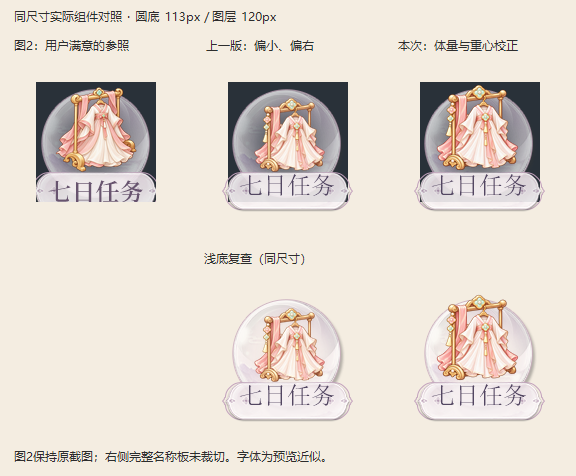

# 主体占比与视觉重心：用户确认的第二轮验证

首轮试制虽然有真实组件规划，却仍被用户指出主体偏小、整体视觉偏右。这说明输入链路完整、不明显遮挡和几何居中，都不足以证明构图满意。

第二轮以用户图2为本图体量参照。先规划更充分的主体占比和视觉补偿，再调用图像编辑；生成返回比规划偏大，随后用有记录的等比例缩放与透明画布定位落实目标。没有将“生成器直接准确执行”作为结论。高清和120px均为新候选，不改已确认文件。

左列为用户图2原截图，中列为首轮试制，右列为第二轮校正；圆底113px、图标层120px。右侧显示完整名称板，左列保留原截图裁切；字体为预览近似。用户明确回复：**“右边这版的主体占比和视觉重心可以。”** 确认绑定[记录与文件哈希](cases/composition-optical-20261023/acceptance.json)，不是对未来改稿的预先认可。

本图的主体诊断框从[26,16,97,90]调整到[16,3,98,88]，诊断使用alpha>16，仅辅助观察而非透明边缘验收阈值。缩放、定位记录保留在[案例变换记录](cases/composition-optical-20261023/transform.json)。**所有数值仅属于本图，不能写入通用提示词、模板默认值或全局放大/偏移规则。**

通用改进：制作前写明主体占比目标与来源、视觉重心判断依据和同尺寸验证方法；实际组合中分别检查体量、视觉平衡与遮挡。程序将目标加入生成参数，并要求两遍组合审核记录这两项、绑定实际对照证据。缺项不能通过；程序不自动判断视觉居中。

确认范围仅为这一版本的主体占比与视觉重心。极淡alpha残留、完整文件规格、画风保持、引擎和真机验收仍须分别检查。本案例不增加正式参考图库数量，不替换任何已确认图标。
