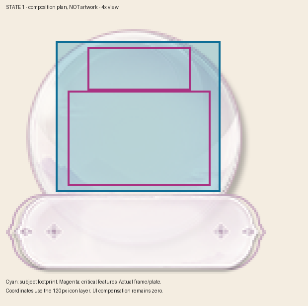
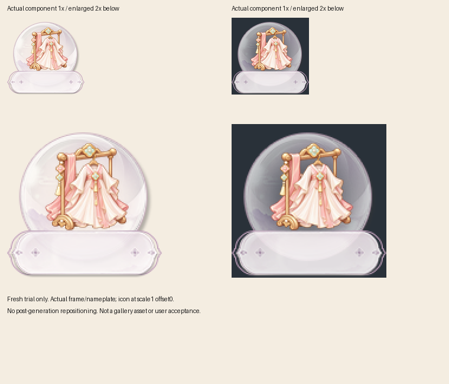

# 制作前构图修复：真实案例验证

**后续更正：用户认为此首轮试制主体偏小、视觉重心偏右，不能作为构图效果通过的正例。后续同尺寸对照及明确确认见[第二轮验证](composition-optical-validation.md)。以下保留首轮历史过程及其技术边界。**

日期2026-10-23。对象为真实时装衣架衣裙任务；使用该任务已确认静态圆底113×113、名称板131×40及其位置、层级和RGBA资源。单状态静态组件验证，不覆盖生产字体、引擎或真机。

## 已确认的问题与修改

旧规则已有先组合后制作要求，但旧start只核对颜色、参考和控制卡描述，缺少实际组合规划的执行检查。因此不能把问题归结为“再写一条注意名称板”。旧时装生产计划没有新的构图证据，新start实际拒绝了它；不改写原计划或历史结论。

新增可执行流程：真实资源/hash/层级检查 → 识别区域与遮挡检查 → 可复现规划图及看图记录 → start封存 → prepare-request将同一规划图和约束传给工具 → 调用回执一致性 → 输出主布局保持一致。

## 前瞻试制

先查看用户内容参考、R04材质画风参考、固定十参考面板和实际规划图，再保存计划并start，准备参数，最后实际调用一次image_gen.imagegen。没有使用已确认成品进行重绘。时间与真实参数摘要见[生成记录](cases/composition-preflight-20261023/generation-summary.json)。完整原始计划和工具回执保留在执行工作区；公开摘要移除机器绝对路径，不冒充新的可执行生产计划。



实际返回1254×1254透明图，完整画布等比例导出120px，未裁切、移动、缩放主体或清理alpha后再凑适配结果。组合使用图层scale=1、offset=[0,0]，真实底框与名称板独立叠加。



**观察：**在实际120px浅深背景下，衣架、衣裙识别面和下摆可辨识，名称板未明显遮住主体；与规划的上部留白方向一致。这是同一审阅者的视觉观察，不是用户确认。

**严格像素结果仍失败：**规划主体[19,13,102,89]，120px非零alpha包围框为[24,13,104,92]；alpha>16诊断框为[26,16,97,90]。名称板与图标alpha乘积交叠框[44,90,78,92]；双方alpha>16的交叠像素为0。阈值只用于解释极淡边缘，不放宽验收；原源图也有极淡外围残留。没有伪造精确服从规划、没有将这张图入库或替换已确认版本。

**能证明：**真实组件和构图在生成前进入了封存计划及实际工具参数，首轮组合可视结果已检查，像素偏差如实暴露。**不能证明：**提示词保证精确像素、一轮成品通过、总体返工率降低或所有新图自动适配。此样本不是严格受控的画质对比实验。

## 拦截验证

[实际结果](cases/composition-preflight-20261023/negative-results.json)包括6个被拒绝的情况：旧生产计划；v2缺composition；主体伸入真实名称板；有布局但缺规划图；改区域但沿用旧图；实际参数移除规划图。新计划→start→准备请求→真实调用→回执→源图链通过。另有合成行为测试覆盖资源变化、占位布局、UI补偿、独立图标、伪造规划图、生成阶段顺序和输出布局替换；合成测试不算视觉验证。最终178项回归全部通过；技能结构校验与本机固定入口的真实案例重放通过。

```text
python -B scripts/replay_composition_case.py
```

该命令只读校验随附文件hash、真实组件规划图重放、三类实际资源负例、原始生成图到120px的直接缩放和已记录越界。`process_replay=pass`与`trial_pixel_bounds=fail`同时保留，不能用前者替代资源验收。不会调用生成工具或修改文件。

## 规则归属

通用：先绑定实际组件、规划主体及识别面、审阅规划图、将相同规划用于生成，生成后仍核查像素。仅本例：圆底/名称板尺寸、衣架衣裙、粉白浅金、[19,13,102,89]等坐标、不允许主体遮挡。正式58枚图库及所有既有assets保持字节不变；试制仅在案例目录，不进入参考图库。
