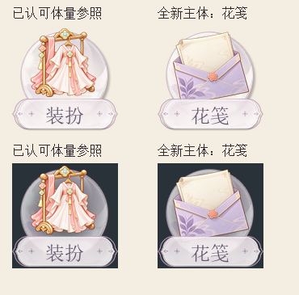

# 有限非关键遮挡：真实新主体验证

状态：用户已授权同步已验证的技能修复，保留源色域未验证；不是正式图库入库，花笺不判为完整交付通过。

2026-10-23用户指出水壶为了全部避让而偏小，随后否定水壶造型并要求换主体。全新生成花笺采用实际项目资源入口，生成前已把信笺、折面、封缄列为关键识别区，允许信封下角进入名称板后方。用户明确确认“这版主体占比可以”。该确认仅覆盖本版占比，不等于所有美术或工程项均获接受。

普通流程必须区分关键面与非关键边缘，不把全避让当体量合格的替代。程序入口将未选策略保留为null；prepare-request在允许有限遮挡时明确要求保护关键面而非整个轮廓。关键识别区穿过实际前景alpha仍被阻断。没有用户或项目依据时不自动许可遮挡，更不把本图缩放、位移、遮挡深度推广到其他项目。

技术修复：为实际全画布等比缩放与留白定位增加可重放导出记录；定位拒绝丢失非透明像素。只按既有规则清理远离主体的alpha=1残点，强像素和RGB保留。修复前后120px RGBA完全一致；采用本图专属边界，不放宽全局102px默认。工作PNG采用明确记录的sRGB解释，原生成文件缺色域声明，source仍unverified，不能据补标签将完整交付判pass。详见[事实记录](cases/limited-occlusion-20261023/facts.json)。

更新范围是制作前选择与验证方法，真实图的体量反馈只属于此案例；没有声称跨案例首轮命中率或独立盲测。原参考资源保持字节不变。
