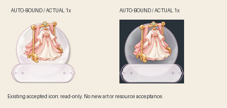

# 本项目入口图标的资源复用入口

本项目身份为`xgf-entry-icons`，用途`entry-icon`。用户已明确授权同一项目自动复用已确认圆底、名称板和布局，不再重复询问。资源由技能的`projects/entry-icons/profile.json`定位及校验，不再要求从历史聊天或案例目录猜测路径。

## 新任务先运行

从当前项目工作目录执行：

```powershell
& <技能目录>/scripts/run-local.ps1 -Operation new-task -Arguments @('<新的任务目录>')
```

其他已具备Pillow的环境使用：

```text
python -B <技能目录>/scripts/project_resources.py <新的任务目录>
```

不传入底框、名称板或布局路径，也不让用户再次提供它们。程序从当前目录向上查找最近的`.xgf-project.json`，遇到独立Git项目边界停止继承；校验项目身份、用途、组件包及全部文件哈希，再生成：

- `resources/`：原字节复制的真实组件、布局、原确认依据和本次复用授权。
- `inputs/component-binding.json`：项目来源、组件与布局的版本绑定。
- `inputs/composition.json`：已绑定真实布局、依据、frame/nameplate角色的构图草稿。

随后只需按本图填写主体范围、识别面、体量及视觉重心等构图内容，生成并看规划图，按已有流程start、prepare-request。构图草稿的unverified表示新图尚未规划与审核，**不表示已确认组件缺失或需要重新向用户索取**。不要覆盖已完成任务；旧任务继续使用自己的冻结版本。

## 项目范围

本工作区及对应Git仓库根目录提供`.xgf-project.json`。项目身份不是目录名猜测；在其他项目安装同一技能，不会自动启用此组件。显式绑定示例保存在`projects/entry-icons/project-binding.example.json`，仅在已确认同一项目身份时使用，不能为消除错误而给陌生项目随手添加。

未知项目、不同用途、嵌套独立项目、资源哈希冲突均不回退到本项目组件。先检查已有项目资料及身份，只有真实缺口或冲突无法解决时才询问具体差异，不能先泛泛要求重新发PNG。用户明确更换组件时按新要求另建绑定，旧文件保留。

固定的是本项目已确认组件关系，不是每枚主体占比、大小、偏移或配色。圆底、名称板独立保留，UI图标层仍为120px且零额外补偿。字体和背景的预览近似、引擎未验证状态保持原记录。

2026-10-23本项目用户明确允许非关键部分适度被名称板遮挡。新图制作前应按语义列出允许部位和限度、保护关键识别面，不为全避让而整体缩小。草稿的allow_noncritical_overlap=null是待执行者选择策略，不表示需要再次向用户询问已有许可；它也不把许可带到其他项目。花笺验证见[案例](limited-occlusion-validation.md)。

## 新任务验证

独立进程新建任务时未传任何组件路径，自动发现项目身份，校验圆底及名称板原哈希，任务布局检查通过。新任务使用自己的资源复制件生成规划图、只读实际组合，并通过start和prepare-request；准备参数包含这张自动绑定资源形成的规划图。



这不是新绘图：以已确认图标做只读组合验证，图标字节不变，不声称完成新的美术验收。[事实记录](cases/project-resource-entry-20261023/facts.json)保留验证范围。行为测试另覆盖未知项目、最近项目绑定、Git边界、资源篡改、已有任务防覆盖与跨项目输出阻断。
